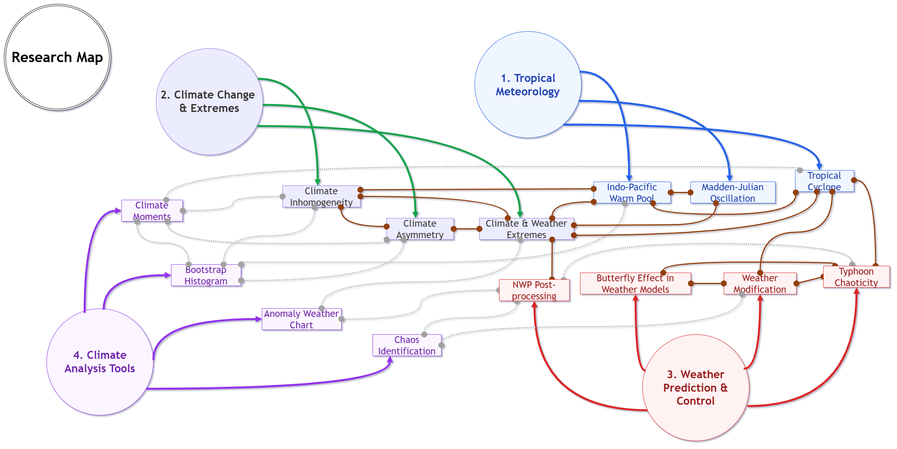

# About Me

<body>

 
 
</body>

<!-- # Jeremy C.H. Leung's Research Homepage -->

## Jeremy Cheuk-Hin Leung 梁卓軒

**Research Associate Professor**

College of Meteorology and Oceanography, National University of Defense Technology

Changsha, China

 

## PROFESSIONAL EXPERIENCE
- 2024-Present, Research Associate Professor, College of Meteorology and Oceanography, National University of Defense Technology

- 2019-2024, Research Associate, Guangzhou Institute of Tropical and Marine Meteorology, China Meteorological Administration

## EDUCATION
- 2014-2019, Peking University, PhD in Atmospheric Science

- 2010-2014, The Chinese University of Hong Kong, BSc in Physics 

## RESEARCH INTERESTS
- Tropical Climate, Madden-Julian Oscillation, Indo-Pacific Warm Pool

- Climate Change, Climate Inhomogeneity & Asymmetry

- Climate & Weather Extremes

- Tropical Cyclone Predictability

- Analysis Tools in Atmospheric Science

More about [our research](/projects)

(Research map)
<!-- [[Jeremy research map.png]]  -->
<body>

 
 
</body>

## SELECTED PUBLICATIONS
- Leung, J. C. H., Zhang, B.\*, Gan, Q., Wang, L., Qian, W., & Hu, Z. Z. (2022). Differential expansion speeds of Indo-Pacific warm pool and deep convection favoring pool under greenhouse warming. _npj Climate and Atmospheric Science_. ([Link](https://www.nature.com/articles/s41612-022-00315-w))

- Liu, J.#, Leung, J. C. H.#, Zhao, D., Xu, D., Huang, H., Zang, Z., Tian, W., Ma, Y., Li, Y.\*, & Zhang, B\*. (2026). Warming Climate Has Lengthened Global Intense Tropical Cyclone Seasons. *Nature Communications*. ([Link](https://www.nature.com/articles/s41467-026-74651-3))

- Gan, Q., Leung, J. C. H.\*, Dong, W.\*, Shi, J., Wang, L., Li, W., Qian, W., Kong, H., & Zhang, B. (2026). Contrasting Long-Term Trends in Near-Surface and Subsurface Indo-Pacific Warm Pool Volume Seasonality. *Journal of Climate*. ([Link](https://doi.org/10.1175/JCLI-D-25-0334.1))

- He, W., Yang, Y., Leung, J. C. H.\*, Xiang, K., Wei, D., Cai, B., Kong, H., Tu, S., Zhang, B. (2025). Enhancing MJO convective activity in the twentieth century. *Journal of Climate*. ([Link](https://journals.ametsoc.org/view/journals/clim/aop/JCLI-D-25-0126.1/JCLI-D-25-0126.1.xml))

- Gan, Q.\#, Leung, J. C. H.\#, Dong, W., Yang, Y., Zhao, D., Li, Y.\*, Zhang, R., & Zhang, B.\*. (2026). Beyond Global Mean Temperature: Increasing Asymmetry of Global Warming in Past and Future Climate Change. *npj Climate and Atmospheric Science*. ([Link](https://www.nature.com/articles/s41612-026-01411-x))

- Ye, G., Leung, J. C. H.\*, Dong, W.\*, Toumi, R., Xu, J., Li, W., Qian, W., Kong, H., & Zhang, B. (2026). A Reanalysis-Based Global Tropical Cyclone Tracks Dataset for the Twentieth Century (RGTracks-20C). *Earth System Science Data*. ([Link](https://essd.copernicus.org/articles/18/3587/2026/))

- Zheng, Y.\#, Leung, J. C. H.\#, Li, S.\*, Zhang, B.\*. (2026). Anthropogenic climate change is causing stronger and more extreme Western Pacific Subtropical High. *National Science Review*. ([Link](https://doi.org/10.1093/nsr/nwag497))

More publications [here](/publications)

## RESEARCH FUNDINGS
Our research are supported by the following research grants:

- **National Natural Science Foundation of China (China):** On the long-term change in the seasonality of Indo-Pacific Warm Pool and its impacts on the seasonality of tropical intraseasonal oscillation (PI, Grant# 42405038, 2025–2027)

- **Guangdong Basic and Applied Basic Research Foundation (China):** Long-term variability of MJO activity and its impacts on Northwest Pacific tropical cyclones in the past 100 years (PI, Grant# 2020A1515110275, 2020–2023)

- **National Natural Science Foundation of China (China):** Variability of Northern Hemispheric Polar and Arctic Cells and Their Impacts on Mid-High Latitude Climate Anomalies (Co-I, Grant# 41775067, 2018–2021)
<!-- - **Guangdong Province Introduction of Innovative R&D Team Project (China):** *R&D on Key Technology in Typhoon Numerical Prediction Model* (Co-PI, Grant# 2019ZT08G669, 2020–2025) -->

## HONORS / AWARDS
- Core Member of Guangdong Province Introduction of Innovative R&D Team, 2023-2025

- Meteorological Technology Progress Award (2nd Prize), China Meteorological Society, 2018

- National Scholarship & Baosteel Scholarship & 1st Prize of Scholarship for Hong Kong, Macau & Taiwan students, Peking University, 2014-2019

## PROFESSIONAL SERVICES / ACTIVITIES
<!-- - Associate Editor, [Climate Dynamics](https://link.springer.com/journal/382) -->

- Peer-review for journals including *Nature*, *Bulletin of the American Meteorological Society*, *Climate Dynamics*, *Journal of geophysical research - Atmospheres*, *Environmental Research Letters*, *Environmental Research Communications*, *Atmospheric Research*, *International journal of climatology*, *Natural Hazards*, etc.

- Associate Member, [Institute of Physics](https://www.iop.org/)

- Member, [Asia Oceania Geosciences Society](https://www.asiaoceania.org/)

- Member, [China Society for Industrial and Applied Mathematics](https://csiam.org.cn/)

- Member, [Chinese Meteorological Society](http://www.cms1924.org/) 

- Member, [European Geosciences Union](https://www.egu.eu/)
<!-- - Executive Committee Member, [Hong Kong Association of China Business](https://www.hkacb.org/) -->
<!-- - Visiting Associate Professor, [Faculty of Data Science, City University of Macau](https://fds.cityu.edu.mo/) -->

## CONTACT / RESEARCH PROFILES
- Email: chleung@pku.edu.cn 

- ORCID: [0000-0002-4325-1083](https://orcid.org/0000-0002-4325-1083)

- Web of Science: [AAW-7595-2020](https://www.webofscience.com/wos/author/record/AAW-7595-2020)

- Google Scholar: [Jeremy Leung](https://scholar.google.com/citations?user=pm1ObhgAAAAJ&hl=zh-TW)

- ResearchGate: [Jeremy-Cheuk-Hin-Leung](https://www.researchgate.net/profile/Jeremy-Cheuk-Hin-Leung)

